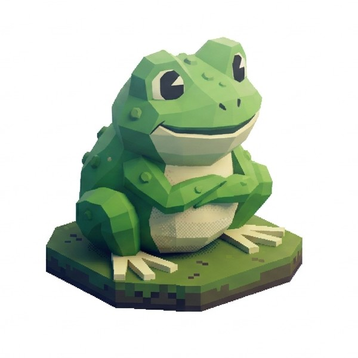

<p align="center">
  
</p>

<h1 align="center">Frogstation</h1>

<p align="center">
  Frontend de NES com biblioteca de capas, no estilo do DuckStation.<br>
  Gamepad, remapeamento de controles e save states.
</p>

<p align="center">
  
  
  
</p>

---

## Recursos

- **Biblioteca com capas:** grade de capas com busca e zoom. As ROMs são identificadas pelo CRC32 (DAT No-Intro) e as capas vêm do libretro-thumbnails, com cache local.
- **Emulação com o Mesen:** usa o núcleo Mesen via libretro, carregado em tempo de execução.
- **Gamepad (SDL2):** conexão a quente, 2 jogadores, analógico esquerdo como direcional e gatilhos LT/RT mapeáveis.
- **Remapeamento:** tela de controles para teclado e gamepad, com atalhos configuráveis.
- **Save states:** 10 slots por jogo, com miniatura, e SRAM de bateria gravada ao fechar.
- **Menu de contexto no jogo:** estados, slot, reiniciar, tela cheia e controles.

## Requisitos (Windows)

- Visual Studio 2022 (carga **Desenvolvimento para desktop com C++**) e CMake 3.21 ou superior
- Qt 6.5 ou superior, MSVC 64-bit, com os módulos Widgets, Sql, Network e **Multimedia**
- `mesen_libretro.dll` (x86_64): <https://buildbot.libretro.com/nightly/windows/x86_64/latest/>
- SDL2: **baixado automaticamente** pelo CMake (pacote oficial `SDL2-devel-*-VC.zip`).
  Para usar outro SDL2, passe `-DSDL2_DIR=<pasta com sdl2-config.cmake>`.

## Compilar

```bat
cmake -S . -B build -G "Visual Studio 17 2022" -A x64 -DCMAKE_PREFIX_PATH=C:\Qt\6.12.0\msvc2022_64
cmake --build build --config Release
C:\Qt\6.12.0\msvc2022_64\bin\windeployqt.exe build\Release\Frogstation.exe
```

Ajuste o caminho do Qt para a sua versão. A `SDL2.dll` é copiada automaticamente para `build\Release\`.
Coloque o `mesen_libretro.dll` em `build\Release\cores\`.

## Gerar o pacote portátil (.zip)

Para compartilhar o programa sem exigir que ninguém compile nada, gere uma pasta que roda direto após descompactar:

```bat
tools\package.bat
```

(ou `powershell -ExecutionPolicy Bypass -File tools\package.ps1`). O script compila em Release, copia as DLLs
do Qt e do SDL2, inclui o `mesen_libretro.dll` e cria `dist\Frogstation-<versão>-win64.zip`.
Opções úteis: `-QtDir C:\Qt\6.12.0\msvc2022_64`, `-Version 0.2.0`, `-CorePath <arquivo.dll>` e `-NoCore`.

Quem recebe o `.zip` só precisa descompactar numa pasta com permissão de escrita (não em Program Files) e executar o
`Frogstation.exe`. O pacote traz um arquivo `portable.txt`, que ativa o **modo portátil**: biblioteca, capas, estados
e configurações ficam na pasta `data\`, ao lado do executável. Para publicar, anexe o `.zip` a um
[Release](https://docs.github.com/pt/repositories/releasing-projects-on-github) do GitHub.

Se o seu `.zip` incluir o `mesen_libretro.dll` (GPL v3) e as DLLs do Qt (LGPL v3), mantenha os arquivos `LICENSE` e
`THIRD-PARTY-NOTICES.txt` que o script já coloca no pacote.

## Releases automáticos (GitHub Actions)

O workflow `.github/workflows/release.yml` compila o projeto em um servidor Windows do GitHub e gera o `.zip` portátil:

- **A cada push na `main` ou pull request:** compila e guarda o `.zip` como *artifact* (aba **Actions**, por 14 dias). Serve para testar e detectar erros de compilação.
- **Ao criar uma tag `v*`** (por exemplo `v0.1.0`): compila e publica o `.zip` em um **Release** do GitHub, com notas geradas automaticamente.

Para lançar uma versão no GitHub Desktop: aba **History** > clique com o botão direito no commit desejado > **Create Tag…** > nome `v0.1.0` >
**Push origin**. O Release aparece em alguns minutos, na página do repositório, em **Releases**.

## Primeiros passos

1. Abra o `Frogstation.exe` e clique em **Adicionar pasta de ROMs…**. O programa procura os arquivos `.nes`, identifica cada jogo e baixa as capas na primeira vez.
2. Dê um duplo clique numa capa para jogar.
3. Clique com o botão direito na janela do jogo para abrir o menu (estados, slot, controles).

As capas e a biblioteca ficam em `%APPDATA%\Frogstation\Frogstation\` (ou em `data\`, ao lado do `.exe`, no pacote portátil).

## Controles

Abra **Controles…** (barra de ferramentas ou menu do jogo), clique na célula de teclado ou de controle e pressione a tecla ou o botão desejado.
`Delete` limpa o mapeamento e `Esc` cancela. O primeiro gamepad é o jogador 1 (junto com o teclado) e o segundo é o jogador 2.

| Ação | Teclado (padrão) | Controle (padrão) |
|---|---|---|
| Direcional | Setas | D-Pad ou analógico esquerdo |
| A / B | X / Z | Botão da direita / botão de baixo |
| Start / Select | Enter / Shift | Start / Back |
| Salvar / carregar estado | F2 / F4 | não definido |
| Slot anterior / próximo | F6 / F7 | LB / RB |
| Reiniciar | F1 | não definido |
| Tela cheia | F11 | não definido |
| Fechar o jogo | Esc (fixo) | não definido |

## Save states

Cada jogo tem 10 slots, com uma miniatura do momento salvo. Os arquivos ficam em
`%APPDATA%\Frogstation\Frogstation\states\` (`<jogo>.stateN` e `<jogo>.stateN.png`).
A SRAM de bateria é gravada em `saves\` ao fechar o jogo.

Um estado só é garantido para a mesma versão do núcleo (`mesen_libretro.dll`) que o criou.

## Estrutura do código

| Arquivo | Função |
|---|---|
| `Core.*` | Wrapper libretro (sem Qt), com serialização para estados |
| `GameWindow.*` | Vídeo, áudio, entrada, estados e menu de contexto |
| `InputConfig.*` | Mapeamentos de teclado e gamepad (salvos em `settings.ini`) |
| `Gamepad.*` | SDL2 GameController: conexão a quente, 2 jogadores, analógico e gatilhos |
| `InputDialog.*` | Tela de remapeamento |
| `Library.*` | SQLite e varredura com hash |
| `NoIntroDat.*` | Identificação por CRC32 |
| `CoverManager.*` | Download e cache de capas |
| `MainWindow.*` | Grade de capas, busca e zoom |
| `tools/package.ps1` | Gera o pacote portátil `.zip` |

## Próximos passos

Shaders e filtros CRT, ROMs em `.zip`, opções do núcleo (paleta, overscan), favoritos,
filtro por ano e gênero, salvamento automático ao sair e rebobinar.

## Licença

Frogstation é software livre, distribuído sob a **GNU General Public License v3.0** (veja [LICENSE](LICENSE)).

Dependências (não incluídas neste repositório):

- [Qt 6](https://www.qt.io/): LGPL v3 (ligação dinâmica)
- [SDL2](https://libsdl.org/): zlib (baixado pelo CMake durante o build)
- [libretro.h](https://github.com/libretro/libretro-common): MIT (incluído em `src/`)
- Núcleo [Mesen](https://github.com/libretro/Mesen): GPL v3 (carregado em tempo de execução; baixe separadamente)

Este projeto não inclui nem distribui ROMs. Use apenas jogos que você possui legalmente.
